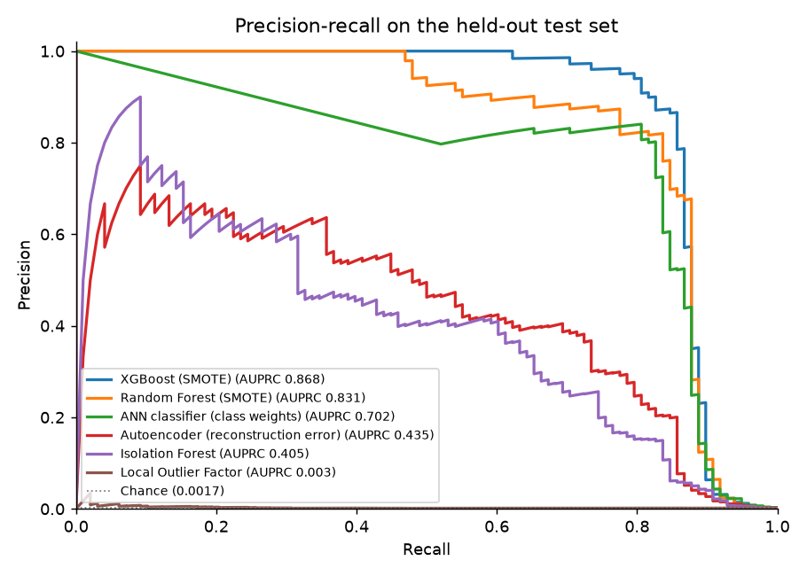
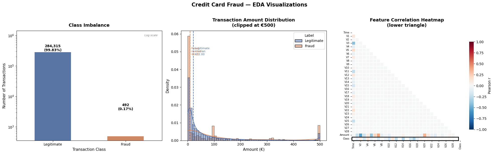

# Credit Card Fraud Detection

Detecting fraudulent card transactions in a heavily imbalanced dataset (0.17% fraud), comparing supervised, unsupervised and deep-learning models under a clean train / validation / test protocol.

Two-person course project at NMIMS by Kartik Agrawal and Ananya Baweja. See [Team](#team).



**Headline:** XGBoost with SMOTE reaches **0.868 AUPRC** on a held-out test set that no model, threshold or
feature statistic ever saw during training. At a threshold chosen on the validation set, it catches 75 of the 98
test frauds with 3 false alarms.

## What it does

1. **EDA:** class balance, amount and time distributions, and correlations.
2. **Feature engineering:** grows the 30 raw features to 55.
3. **Model training:** six models, from gradient boosting to anomaly detection to deep learning.
4. **Evaluation:** metrics suited to imbalanced data. AUPRC comes first, then ROC-AUC, and F1, precision and
   recall on the fraud class at a threshold chosen on validation data.

## Evaluation protocol

The first version tuned each model's threshold on the test set and reported F1 on that same set, which made F1,
precision and recall optimistic. The pipeline now:

1. **Splits** the 284,807 transactions **60 / 20 / 20** into train, validation and test, stratified, seed 42:
   - Train: 170,883 rows (295 fraud)
   - Validation: 56,962 rows (99 fraud)
   - Test: 56,962 rows (98 fraud)
2. **Fits everything that learns from data on the training rows only:** feature quantiles and time range, the
   scaler, and SMOTE (fraud upsampled to 10% of legitimate). Then it fits the models.
3. **Chooses each model's decision threshold on the validation set,** by maximising F1. The ANN also uses
   validation for early stopping.
4. **Scores the test set once.**

## Results

| Model | AUPRC | ROC-AUC | F1 (fraud) | Precision | Recall | Frauds caught | False alarms |
|---|---|---|---|---|---|---|---|
| **XGBoost (SMOTE)** | **0.8678** | 0.9767 | **0.8523** | **0.9615** | 0.7653 | 75 / 98 | 3 |
| Random Forest (SMOTE) | 0.8310 | 0.9730 | 0.8205 | 0.8247 | 0.8163 | 80 / 98 | 17 |
| ANN classifier (class weights) | 0.7018 | **0.9791** | 0.8187 | 0.8316 | 0.8061 | 79 / 98 | 16 |
| Autoencoder (reconstruction error) | 0.4350 | 0.9653 | 0.3368 | 0.2115 | **0.8265** | 81 / 98 | 302 |
| Isolation Forest | 0.4053 | 0.9624 | 0.4581 | 0.4031 | 0.5306 | 52 / 98 | 77 |
| Local Outlier Factor | 0.0033 | 0.4986 | 0.0000 | 0.0000 | 0.0000 | 0 / 98 | 53 |

The test set holds 56,962 transactions (98 fraud). The thresholds come from validation: 0.9825 for XGBoost,
0.7198 for Random Forest and 0.999 for the ANN. [`results/metrics.json`](results/metrics.json) has the rest,
plus the confusion matrices and validation F1.

**Reproduce:** `python -m src.evaluate`. It takes about 14 minutes on 4 CPU threads, with the Keras models on
CPU. A second full run (executing the notebook) reproduced every number exactly.

### Compared with the first version

| | First version (threshold tuned on test) | Now (threshold tuned on validation) |
|---|---|---|
| XGBoost AUPRC | 0.8620 | 0.8678 |
| XGBoost F1 / precision / recall | 0.8696 / 0.9302 / 0.8163 | 0.8523 / 0.9615 / 0.7653 |
| Random Forest F1 | 0.8247 | 0.8205 |
| ANN F1 | 0.8265 | 0.8187 |

- **F1 dropped for every supervised model, as expected** once the test set no longer chooses the threshold.
- **AUPRC changed only a little.** It doesn't depend on a threshold, but it moves because the models now train
  on 60% of the data instead of 80%, and the test rows differ.
- **XGBoost's F1 is 0.8235 at the default 0.5 threshold.** Tuning on validation raises it to 0.8523.

What the results show:
- **XGBoost has the best AUPRC and F1.** Its most important features are `fraud_signal` (0.213) and
  `Amount_x_V4` (0.135), both engineered, then `V14` (0.054).
- **The supervised models beat the anomaly detectors by a wide margin.** Local Outlier Factor is no better than
  chance here. Its best validation threshold catches no test fraud at all.
- **ROC-AUC hides the differences.** The ANN has the highest ROC-AUC but only the third-best AUPRC. With 0.17%
  fraud, AUPRC is the more informative ranking.

## How it works

### Data
- The data is 284,807 European card transactions over about 48 hours, of which 492 are fraud (0.1727%).
- Features `V1`–`V28` are PCA components (anonymised by the dataset's authors), plus `Time` and `Amount`.
- Source: the ULB Machine Learning Group's dataset:
  - Kaggle: [mlg-ulb/creditcardfraud](https://www.kaggle.com/datasets/mlg-ulb/creditcardfraud)
  - OpenML: [dataset 1597](https://www.openml.org/d/1597), listed as public. Kaggle lists it under the Open
    Database License.
- Please cite: Dal Pozzolo et al., *Calibrating Probability with Undersampling for Unbalanced Classification*,
  IEEE SSCI 2015.
- `src/data.py` uses `creditcard.csv` if it's in the repo root. Otherwise it downloads the same data from OpenML
  and caches it in `data/`, which isn't committed.
- It checks for 284,807 rows and 492 frauds before doing anything.
- The file is downloaded directly because `fetch_openml` drops the `Time` column, which OpenML marks as a row
  identifier.



### Feature engineering (30 → 55 features, `src/data.py`)
- **Amount:** `log1p`, square, an is-zero flag and quintile bins.
- **Time:** hour of day, cyclical `sin`/`cos` encoding, night and peak-hour flags.
- **V-feature interactions:** ratios (`V1/V2`, `V3/V4`), products (`V14·V17`, `V2·V4`, `V11·V3`) and absolute
  values.
- **`fraud_signal`:** `(V2 + V4 + V11) − (V3 + V14 + V17 + V12 + V10)`. It combines components that tend to rise
  with fraud and those that tend to fall.
- **Amount × V interactions:** `Amount·V14`, `Amount·V17` and `Amount·V4`.

The quintile edges and the time range come from the training rows.

### Models (`src/train.py`, hyperparameters from the original notebook)
| Model | Type | Imbalance handling |
|---|---|---|
| **XGBoost** (500 trees, depth 6) | Supervised | SMOTE on training rows and `scale_pos_weight` |
| Random Forest (300 trees, depth 10) | Supervised | SMOTE and `class_weight="balanced"` |
| ANN classifier (128-64-32, BatchNorm, Dropout) | Supervised | Class weights |
| Autoencoder (55→64→32→16→32→64→55) | Unsupervised | Trained on legitimate transactions only; the anomaly score is the reconstruction error |
| Isolation Forest | Unsupervised | Contamination set to the training fraud rate |
| Local Outlier Factor | Unsupervised | `novelty=True`; contamination set to the training fraud rate |

## How to run

```bash
python -m venv .venv
source .venv/bin/activate        # Windows: .venv\Scripts\activate
pip install -r requirements.txt  # Python 3.12
python -m src.evaluate           # downloads the data on first run; writes results/ and images/pr_curves_test.png
```

- Without TensorFlow: `python -m src.evaluate --models xgboost random_forest isolation_forest lof`.
- `fraud_detection.ipynb` is the narrative: EDA, then the same `src/` pipeline, with its outputs saved. The first
  version of the notebook, with its original outputs, is in the git history (commit `0221298`).
- Tests (split, feature fitting, SMOTE scope, threshold selection): `pip install -r requirements-ci.txt && pytest -q`.

## Project layout

```
src/
  data.py       load, check, split, feature engineering
  train.py      the six models and validation-based thresholds
  evaluate.py   scores the test set once and writes results/
tests/          pytest suite (synthetic data, runs in seconds)
results/        metrics.json and summary.md from the last run
images/         EDA plot and precision-recall curves
fraud_detection.ipynb   narrative notebook that calls src/
```

## Team

A two-person course project at NMIMS. We contributed equally:

- **Kartik Agrawal**
- **Ananya Baweja**

Each of us built models ourselves and then worked on optimising them.

## Tech stack
Python · pandas · NumPy · scikit-learn · imbalanced-learn (SMOTE) · XGBoost · TensorFlow/Keras · matplotlib · seaborn
