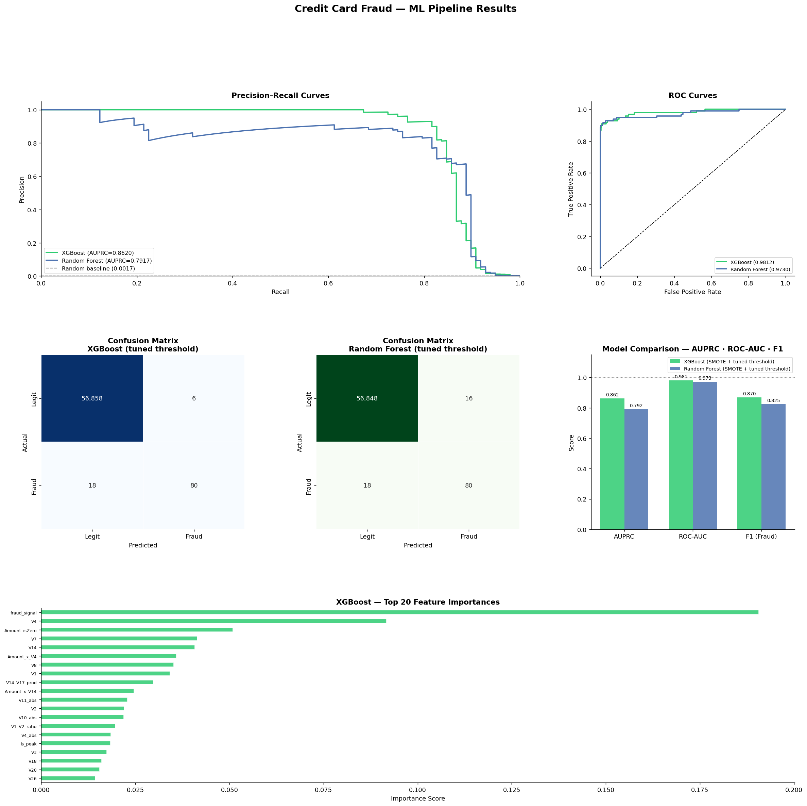
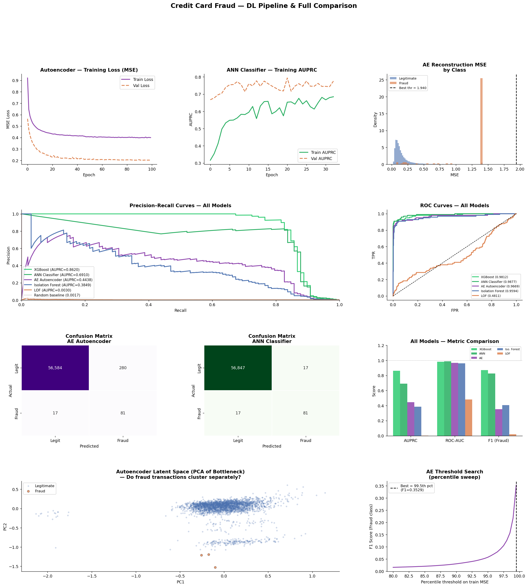

# Credit Card Fraud Detection

Detecting fraudulent card transactions in a heavily imbalanced dataset (0.17% fraud) by comparing supervised, unsupervised and deep-learning models.

Two-person course project at NMIMS by Kartik Agrawal and Ananya Baweja. See [Team](#team).



## What it does

The notebook takes the 284,807 transactions in the Kaggle credit card fraud dataset through this pipeline:

1. **EDA:** class balance, amount and time distributions, and a correlation heatmap.
2. **Feature engineering:** grows the 30 raw features to 55.
3. **Model training:** six models, from classical ML to anomaly detection to deep learning.
4. **Evaluation:** metrics suited to imbalanced data (AUPRC, F1 on the fraud class, precision, recall, ROC-AUC), plus threshold tuning.

## How it works

### Data
- 284,807 transactions over about 48 hours, of which 492 are fraud (0.1727%). That's roughly 578 legitimate transactions for every fraud.
- Features `V1`–`V28` are PCA components (anonymised by the dataset authors), plus `Time` and `Amount`.
- The data is split 80/20, stratified with `random_state=42`:
  - **Train:** 227,845 rows (394 fraud)
  - **Test:** 56,962 rows (98 fraud)

### Feature engineering (30 → 55 features)
- **Amount:** `log1p`, square, an is-zero flag and quintile bins.
- **Time:** hour of day, cyclical `sin`/`cos` encoding, night and peak-hour flags.
- **V-feature interactions:** ratios (`V1/V2`, `V3/V4`), products (`V14·V17`, `V2·V4`, `V11·V3`) and absolute values.
- **`fraud_signal`:** an aggregate score, `(V2 + V4 + V11) − (V3 + V14 + V17 + V12 + V10)`. It combines components that tend to rise with fraud and those that tend to fall.
- **Amount × V interactions:** `Amount·V14`, `Amount·V17` and `Amount·V4`.

### Models
| Model | Type | Imbalance handling |
|---|---|---|
| **XGBoost** | Supervised | SMOTE on the training set (fraud upsampled to 10% of legitimate) and `scale_pos_weight`, plus a tuned decision threshold |
| Random Forest | Supervised | SMOTE, `class_weight="balanced"` and a tuned threshold |
| ANN classifier (128-64-32, BatchNorm, Dropout) | Supervised | Class weights and a tuned threshold |
| Autoencoder (55→64→32→16→32→64→55) | Unsupervised | Trained on legitimate transactions only; reconstruction error is the anomaly score |
| Isolation Forest | Unsupervised | Contamination set to the training fraud rate |
| Local Outlier Factor | Unsupervised | `novelty=True`, contamination set to the training fraud rate |

## Results

All figures come from the saved notebook outputs, on the held-out test set (56,962 transactions, 98 fraud).

| Model | AUPRC | ROC-AUC | F1 (fraud) | Precision | Recall |
|---|---|---|---|---|---|
| **XGBoost (SMOTE + tuned threshold)** | **0.8620** | 0.9812 | **0.8696** | **0.9302** | 0.8163 |
| ANN classifier (tuned threshold) | 0.6910 | 0.9877 | 0.8265 | 0.8265 | 0.8265 |
| Random Forest (SMOTE + tuned threshold) | 0.7917 | 0.9730 | 0.8247 | 0.8333 | 0.8163 |
| Autoencoder | 0.4438 | 0.9669 | 0.3529 | 0.2244 | 0.8265 |
| Isolation Forest | 0.3849 | 0.9594 | 0.4059 | 0.3942 | 0.4184 |
| Local Outlier Factor | 0.0030 | 0.4811 | 0.0211 | 0.0217 | 0.0204 |

What the results show:
- **XGBoost has the best AUPRC and F1.** At its tuned threshold (0.9906) it catches 80 of the 98 test frauds and raises 6 false alarms.
- **Threshold tuning matters.** XGBoost's F1 is 0.8019 at the default 0.5 threshold and 0.8696 at the tuned one.
- **`fraud_signal` is XGBoost's most important feature**, at 0.1907 (19%) importance. Next come `V4` (0.0917) and `Amount_isZero` (0.0509).
- **Supervised models beat the anomaly detectors by a wide margin.** LOF does no better than chance on this data.
- **The ANN has a slightly higher ROC-AUC than XGBoost** (0.9877 vs 0.9812) but a much lower AUPRC. On data this imbalanced, AUPRC is the more informative ranking metric.

> **Caveat on methodology:** the notebook picks each supervised model's decision threshold by maximising F1 on the **test** set. The same set is used to report the results. So F1, precision and recall above are optimistic. AUPRC and ROC-AUC don't depend on a threshold, so they're unaffected. A cleaner setup would tune the threshold on a validation split.



More plots: [EDA](images/eda.png) · [XGBoost threshold analysis](images/xgb_threshold_analysis.png)

## How to run

1. Download `creditcard.csv` (144 MB) from Kaggle: [Credit Card Fraud Detection (ULB Machine Learning Group)](https://www.kaggle.com/datasets/mlg-ulb/creditcardfraud). Put it next to the notebook. It isn't committed to this repo.
2. Install dependencies:
   ```bash
   pip install -r requirements.txt
   ```
3. Open `fraud_detection.ipynb` and run all cells from top to bottom.

Notes:
- The notebook was developed on Google Colab (TensorFlow 2.19.0). The deep-learning cell is much faster with a GPU.
- It includes two ML-pipeline cells: the original XGBoost + Isolation Forest + LOF version, and a later XGBoost + Random Forest version. Run both, because the final comparison cell uses results from the first.
- Plots are saved to `/mnt/user-data/outputs/` (a Colab path). On Windows this becomes `C:\mnt\user-data\outputs\`.

## Team

A two-person course project at NMIMS. We contributed equally:

- **Kartik Agrawal**
- **Ananya Baweja**

Each of us built models ourselves and then worked on optimising them.

## Tech stack
Python · pandas · NumPy · scikit-learn · imbalanced-learn (SMOTE) · XGBoost · TensorFlow/Keras · matplotlib · seaborn
